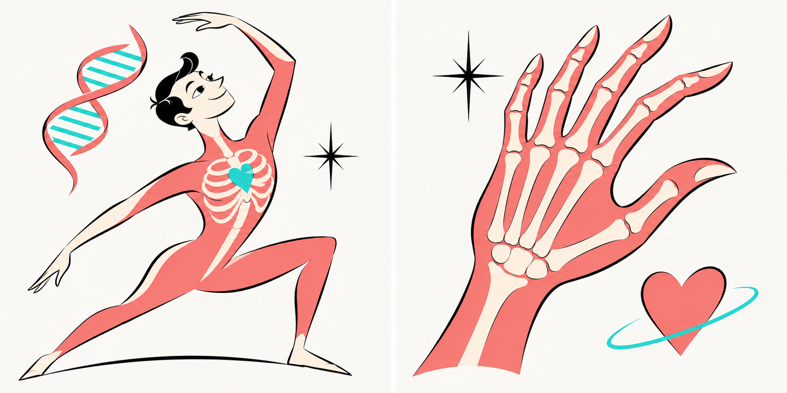
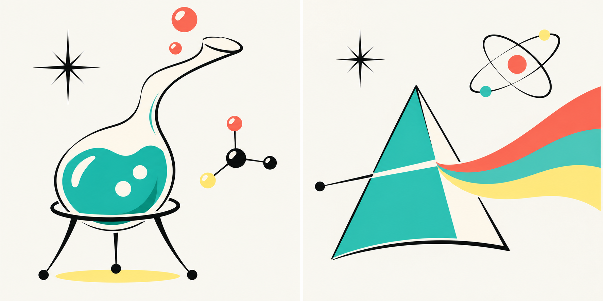
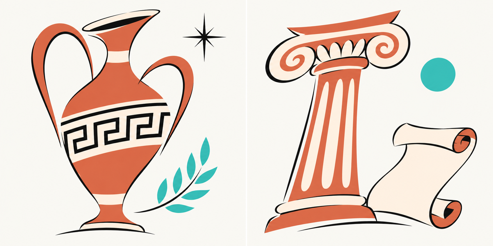
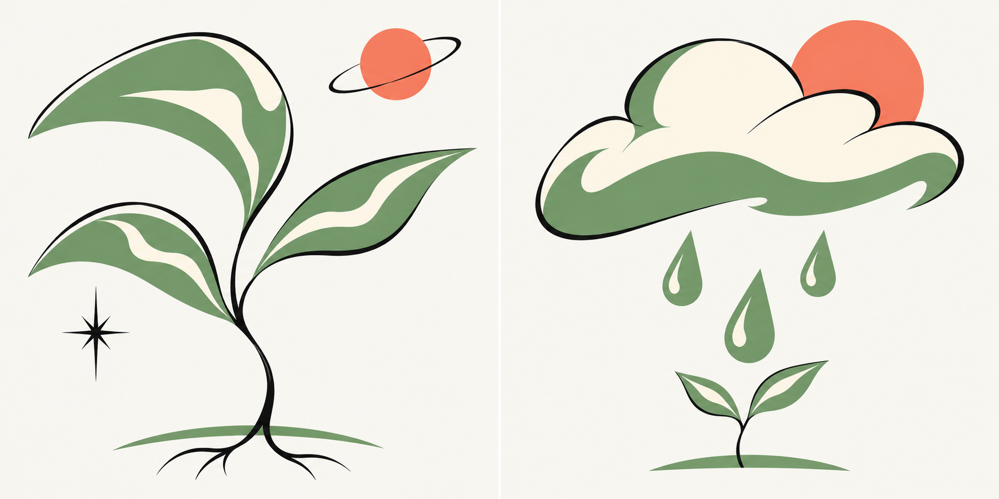

# Neuf thèmes — deux propositions chacun

Recherche G pour #52, 8 novembre 2026. À la demande de Hugo, déclinaison des neuf thèmes restant après le télescope, le léopard et la Terre en coupe. Chaque PNG présente deux propositions : **1 à gauche, 2 à droite**.

Direction : illustration Atomic Age 1950–1960, lignes noires expressives, formes boomerang, silhouettes stylisées, fonds clairs peu jaunes et petites touches vives. **Interdiction permanente des groupes de trois traits en éventail ou traits d’emphase.** La planche de référence F corrigée est `../recherche-f/recherche-sans-traits.png`.

| Thème | Proposition 1, gauche | Proposition 2, droite |
|---|---|---|
| [Corps humain](corps-humain.png) | Silhouette et ADN | Main et cœur |
| [Géographie](geographie.png) | Carte pliée | Globe et itinéraire |
| [Physique et chimie](physique-chimie.png) | Fiole et molécule | Prisme et atome |
| [Constructions et transports](constructions-transports.png) | Train et viaduc | Architecture rétro-futuriste |
| [Histoire](histoire.png) | Amphore et laurier | Colonne et parchemin |
| [Arts et culture](arts-culture.png) | Palette et pinceau | Masque de théâtre et livre |
| [Sport et jeux](sport-jeux.png) | Raquette et pion | Cavalier et ballon |
| [Nombres et mesures](nombres-mesures.png) | Compas et équerre | Boulier et règle |
| [Nature et climat](nature-climat.png) | Plante | Nuage, pluie et pousse |

## Planche par thème

### Corps humain

### Géographie

### Physique et chimie

### Constructions et transports

### Histoire

### Arts et culture

### Sport et jeux

### Nombres et mesures

### Nature et climat

## État des livrables

18 propositions exploratoires regroupées en neuf PNG, générées avec l’outil intégré de création d’images. Les briefs exacts et la provenance des fichiers sont conservés dans `manifest.json`. Les planches ont été inspectées visuellement ; la main à quatre doigts d’une première sortie a été corrigée en cinq doigts. Aucun groupe de trois traits en éventail sur les planches retenues. Les choix restent à valider par Hugo. Les fichiers ne sont pas encore des SVG de production ni des miniatures 24 × 24 ; ces déclinaisons suivront la sélection, avec simplification dédiée et contrôle en contexte mobile. Aucune intégration dans le jeu.
